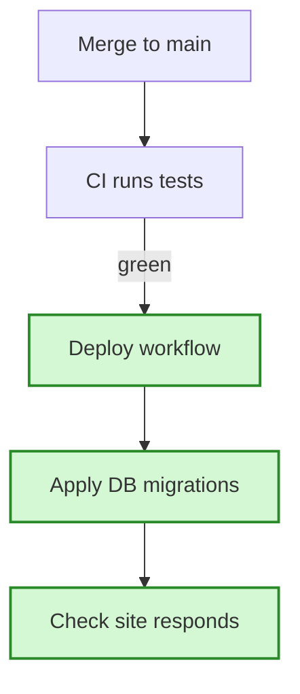

# Plan explainer: `$ARGUMENTS`

Turn a plan into a second file a non-expert can read in five minutes. The plan stays the source of
truth; this file only explains it. Never change the plan itself.

## 1. Find the plan

- `$ARGUMENTS` names a file → use it.
- Otherwise → the plan written in this conversation (the plan-mode file, or the `docs/*plan*.md`
  just written). Not sure which → ask.

Read the whole plan. For each change, open the files it names just enough to describe today's
behavior correctly. Don't guess what exists today. "Today" always means before the plan: if the
code already has the change, describe the old behavior from the plan's own text or `git log`.

## 2. Write the file

Path: next to the plan, same name with `.simple.md` (`docs/deploy-plan.md` →
`docs/deploy-plan.simple.md`). Overwrite it if it exists — it is generated.

**In plan mode** only the plan file may be edited, so write nothing. Instead, every time the plan
file is written or updated, put this same content in your chat message, right before
`ExitPlanMode`, so the user reads the simple version before the full plan. A plan revised after
feedback gets a fresh one. Once the plan is approved, save the last version you printed as the
`.simple.md` file — don't re-derive it.

Language: the language the user writes to you in. Keep code names, file paths and commands as-is.

Structure:

```markdown
# <Plan title> — in simple words

**In one sentence:** <what this plan does and why, for someone who never saw the code>

## The flow after the change

<Mermaid diagram — see section 3>

## <Section 1 name>

**Today:** <how it works now, 1–3 short sentences>
**After the change:** <what will be different, 1–3 short sentences>
**Example:** <one concrete scenario: a real user action, request, or command, walked through before and after>
**What we gain:** <the benefit, in terms of the user, the developer, or the risk removed>

## <Section 2 name>
...

## What is NOT changing

<bullets — only if the plan says so explicitly>

## Watch out for

<bullets: the plan's known limits / risks, one simple line each — omit if the plan has none>
```

Sections: one per meaningful change, grouped the way the plan groups them (by ticket, area, or
step). Merge tiny related changes into one section. Skip pure housekeeping (formatting, a doc
line) unless the plan treats it as a change in its own right.

Plain-language rules:

- Short sentences. One idea each. Explain every term a newcomer would not know, in a few words,
  the first time it appears ("a migration — a script that changes the database structure").
- Examples are concrete: real names, real values, real clicks — "a user saves 'Western Wall'…",
  not "when data is saved…".
- The benefit answers "so what?". "Cleaner code" is not a benefit; "a deploy no longer needs
  someone to run a command by hand" is.
- Don't add anything the plan doesn't say. If the plan doesn't give a benefit, derive it from the
  goal; don't invent new features or numbers.

## 3. The diagram

One Mermaid `flowchart` showing the flow after the change, top to bottom, short node labels.
Mark what the plan adds or changes so it stands out:



- `:::new` on added or changed steps; existing steps plain. Say so in a one-line legend under the
  diagram.
- If the old flow is very different (a step removed or reordered), add a second, smaller
  "Before" diagram above it.
- Fit it on one screen: 15 nodes at most. Too big → one overview diagram, plus one small diagram
  inside a section that needs it.
- Quote labels that contain parentheses, slashes or colons: `A["POST /places (new)"]`.

## 4. Report

Reply with the file path as a link and the one-sentence summary. Nothing else. (In plan mode the
chat message is the report.)
