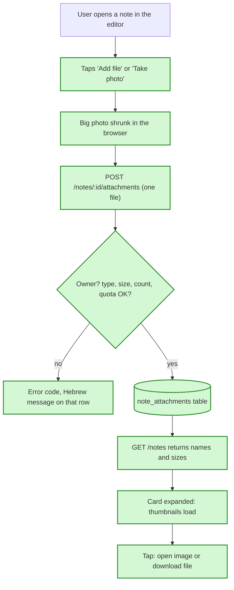

# Attachments plan — in simple words

**In one sentence:** let a user add photos and files to a note, see them on the note, open or
download them, and remove them, with the bytes kept in our own database, where only the note's
owner can reach them.

## The flow after the change

Green = new in this plan.

## Where the files are stored

**Today:** a note can hold text and one voice recording. The recording's bytes sit in a
`note_audio` table in Postgres (ADR 0003). Nothing else can be attached.
**After the change:** a new `note_attachments` table holds any number of files per note (name,
type, size, bytes). A migration (a script that changes the database structure) adds it. Its owner
is the note's owner.
**Example:** Dana adds a receipt PDF to the note "Return the kettle". A row appears in
`note_attachments` linked to that note. If Dana deletes the note and taps Undo, the receipt comes
back with it.
**What we gain:** no new service, key or account. Attachments use the same database, backups and
tests as notes.

## Limits checked by the server

**Today:** only audio has limits (5 MB, four audio types).
**After the change:** a file is at most 10 MB; a note holds at most 20 files; a user has 30 MB in
total; only images, PDFs, text, CSV and Word/Excel/PowerPoint files are accepted. Each break gets
its own error code.
**Example:** Dana picks a 12 MB video. The server answers `413 attachment_too_large`, and the row
shows "הקובץ גדול מדי". The other files she picked still upload.
**What we gain:** the free 500 MB database cannot fill up from attachments, and no file type that
a browser could run as a web page gets in.

## Adding files in the app

**Today:** the editor has text, categories, dates and the audio player.
**After the change:** the editor has "Add file" and "Take photo". On a phone, "Add file" offers
camera, gallery and files. Files upload one at a time, each with its own spinner. Big photos are
shrunk in the browser first (a 4 MB photo becomes about 400 KB).
**Example:** Dana writes "Fix the balcony door" and records nothing. On the review screen she
taps "Take photo", shoots the broken hinge, and the thumbnail appears under the note.
**What we gain:** a photo from the phone takes a few seconds to upload and uses a small part of
the quota.

## Seeing and opening files

**Today:** a card shows text, chips and the audio player.
**After the change:** an expanded card and the editor show image thumbnails and, for other files,
a row with icon, name and size. Tapping an image opens it full size; tapping a file downloads it.
Thumbnails load only when a card is opened.
**Example:** Dana expands "Return the kettle", sees "receipt.pdf · 220 KB", taps it, and the PDF
downloads.
**What we gain:** the list stays fast, because it never downloads file bytes until the user opens
a card.

## Removing a file

**Today:** not possible (nothing to remove).
**After the change:** in the editor each file has a remove button. The first tap asks "Remove?",
the second deletes it.
**Example:** Dana attached the wrong photo. She taps remove, then "Remove?", and it is gone; her
quota goes back up.
**What we gain:** mistakes are easy to fix, and a stray tap does not delete anything.

## Groundwork first (ticket 1)

**Today:** the code that reads an uploaded file only knows about voice audio, and so does the
code in the app that downloads bytes with the sign-in token.
**After the change:** both become general (any field name, any limits, any allowed types), and
voice notes keep working through them.
**Example:** after ticket 1, a voice note records and plays exactly as before; the tests prove
it.
**What we gain:** attachments reuse the same upload and download code instead of a second copy.

## What is NOT changing

- Voice recordings stay where they are and are not attachments.
- Notes sent from the offline outbox, import, and the Android share sheet cannot carry
  attachments yet.
- Claude does not read attachments; search does not look inside them.

## Watch out for

- If all users together come near 300 MB of attachments, move the bytes to Supabase Storage. The
  API stays the same.
- Two uploads at the same moment to two different notes can pass the quota by one file (at most
  10 MB). Accepted.
- Notes the app cached before this change are fetched again once, because their shape changed.
