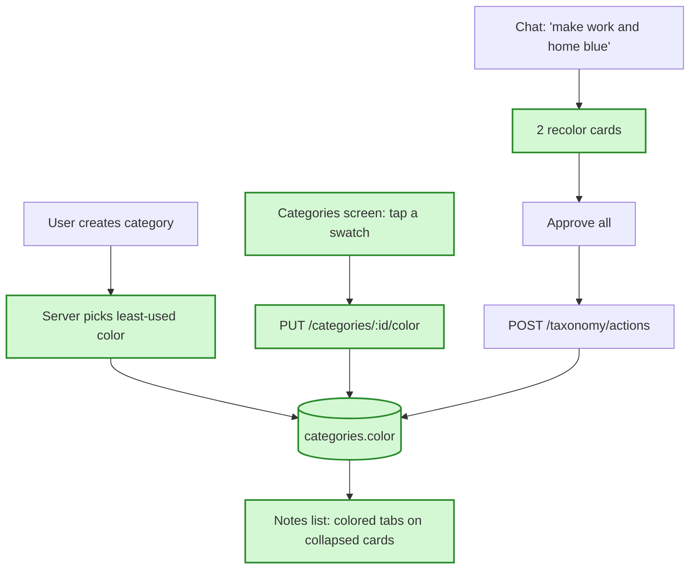

# Category colors — in simple words

**In one sentence:** every category gets one of 8 colors; notes show colored category tabs right
in the list, and you can change a color on the categories screen or by asking the chat ("make
work and home blue").

## The flow after the change

Green = added or changed by this plan.

## 1. Categories have colors, shown in the list (ticket 1)

**Today:** categories have no color. Category names only show when you open (expand) a note card,
as gray pills.
**After the change:** each category stores one of 8 colors (blue, green, purple, orange, teal,
pink, red, gray — no yellow, which marks Claude's suggestions). A new category gets the color your
other categories use least. A migration (a script that changes the database) gives existing
categories different colors in the order they were created. Collapsed note cards show their
categories as colored tabs next to status and due date; tags stay inside the opened card.
**Example:** you have עבודה (blue) and בית (green), then add בריאות — it gets purple. A note
"לשלוח דוח" in עבודה shows a blue tab without opening it.
**What we gain:** you scan the list by color; colors are distinct and never change on their own.

## 2. You change a color (ticket 2)

**Today:** the categories screen lets you add, rename, delete and set importance.
**After the change:** each active category has a row of 8 color circles; one tap saves, the list
repaints.
**Example:** tap the purple circle under עבודה → every עבודה tab turns purple.
**What we gain:** colors match how you think about your categories.

## 3. The chat recolors several categories (ticket 3)

**Today:** chat can propose creating, renaming, deleting or restoring categories and tags, each as
a card you approve.
**After the change:** chat can also propose "recolor". "Make work and home blue" gives two cards,
each previewing the new color, and the existing "approve all (2)" button applies both. Chat still
changes nothing without your approval.
**What we gain:** one sentence and one tap recolors many categories.

## Readable in light and dark

Each color has a soft background and a darker (dark mode: lighter) text color. An automatic test
checks every color in both themes reaches WCAG 4.5:1 for text and 3:1 for the tab edge — the build
fails if a color is unreadable.

## What is NOT changing

- Tags stay neutral. No custom colors outside the 8. Filter chips are not colored.

## Watch out for

- Two categories created at the exact same moment may get the same color; harmless, and you can
  change it.
