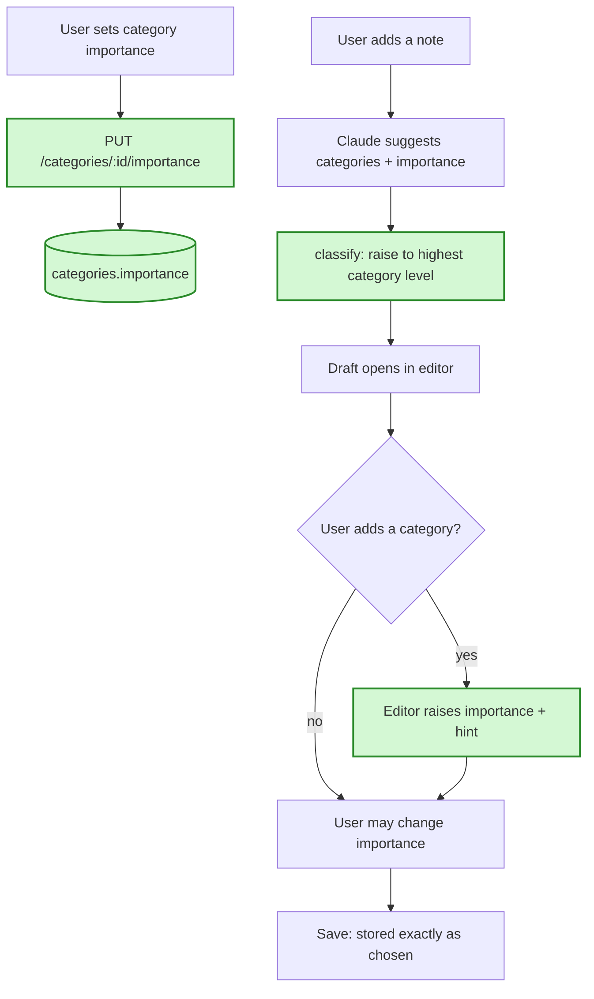

# Category importance, inherited by notes — in simple words

**In one sentence:** each category can have a default importance, and a note picks it up when that category is added to it, but the user can always change the note's importance afterwards.

## The flow after the change

Green = added or changed by this plan.

## 1. Setting a category's importance

**Today:** a category has only a name. The categories screen can add, rename, delete and restore.
**After the change:** each category gets a small three-option switch: none, important or not important. One tap sets it, changes it or clears it. A migration (a script that changes the database structure) adds one optional column.
**Example:** on the categories screen, you tap "important" under "Work". The switch stays on "important" after a reload.
**What we gain:** you decide once that work matters, without marking each note.

## 2. New notes inherit the level

**Today:** a new note's importance is whatever Claude guessed, often nothing.
**After the change:** after Claude's guess, the importance is raised to the highest level among the note's categories. Important beats not important, and not important beats none. The same applies to "re-analyze" and to imported notes.
**Example:** you add "send the monthly report". Claude picks "Work" and guesses "not important". The draft opens as "important" because "Work" is important.
**What we gain:** the rule works the same way everywhere a note gets suggestions, from a single function that is tested once.

## 3. Editing categories in the editor

**Today:** picking categories doesn't touch importance.
**After the change:** adding a category, directly or through one of its tags, raises importance if that category's level is higher. A short hint says which category did it. Removing a category never lowers importance. The user can still change it by hand, and what they save is what's stored.
**Example:** you edit an old note and add the "Work" tag. Importance jumps to "important" with the hint "Set from the category Work". You switch it back to "not important" and save, and it stays "not important".
**What we gain:** you see the change before saving, and you always have the last word.

## What is NOT changing

- Changing a category's importance does not touch notes that already exist.
- Saving a note and confirming an import still store exactly what the user chose.

## Watch out for

- Removing a category doesn't lower importance. The app doesn't record where a level came from.
- Tickets run in order: 1 (set a category's importance), then 2 (new notes inherit), then 3 (editor raises).
