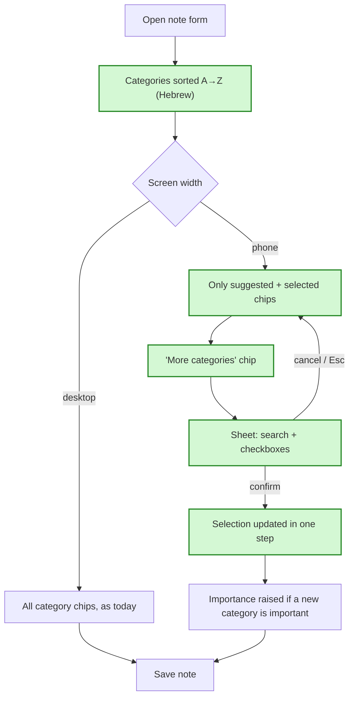

# Category picker plan (issue #88) — in simple words

**In one sentence:** categories in the note form are listed A→Z the Hebrew way, and on a phone the
form shows only the categories Claude suggested, with a button that opens a searchable list for
picking more.

## The flow after the change

Green = added or changed by this plan.

## Alphabetical order (ticket 1)

**Today:** chips come in the order the database returns them. That order is not Hebrew-aware:
English names can jump ahead of Hebrew ones, and Claude's new names are tacked on in random order.
**After the change:** the form sorts names itself with a Hebrew-aware comparison. Tags inside each
category and the "add to" dropdown follow the same order. Claude's new names are sorted too, still
after the existing ones.
**Example:** categories "תל אביב", "Zoo", "אוכל", "בית" show as אוכל, בית, תל אביב, Zoo.
**What we gain:** you find a category where you expect it, on phone and desktop.

## Phone: suggestions inline, the rest in a sheet (ticket 2)

**Today:** on a phone the form shows a chip for every category and tag rows for every category
with tags. With 30 categories that's several screens of chips before the due date.
**After the change:** on screens narrower than 640 px the form shows only the categories Claude
suggested plus any already selected, and only their tags. At the end of the row sits a dashed
"קטגוריות נוספות" chip. It opens a sheet from the bottom with a search box and a checkbox per
category. Suggested ones carry the yellow "suggested" marker. "אישור" applies the checkboxes —
checking adds, unchecking removes. "ביטול", Escape or tapping outside changes nothing. Desktop
looks exactly like today, just sorted.
**Example:** Claude suggests עבודה for "לשלוח דוח". On a phone you see the עבודה chip and the dashed
chip. You open the sheet, type "בי", check בית, confirm. Now בית shows inline next to עבודה. If בית
is marked important, the note's importance rises (the rule from #113 already does this).
**What we gain:** the phone form is short, and finding a category among many is a search, not a
scroll.

## Where it applies

**Today:** one editor serves new drafts, editing a saved note, import rows and offline notes.
**After the change:** all four get the new behaviour. When editing, "suggested" means the note's
current categories. Offline notes have no suggestion, so the phone shows just the dashed chip.
**What we gain:** one editor, one behaviour to learn.

## What is NOT changing

- No server, database or API change.
- No change to how importance is raised — the sheet uses the same path as tapping a chip.
- Creating a new category or tag still happens in the row at the bottom of the form.

## Watch out for

- "Phone" is decided by screen width (640 px), not by device type; a narrow desktop window gets
  the phone layout.
- The "add to" dropdown still lists every category on a phone — it's a dropdown, not a long list.
