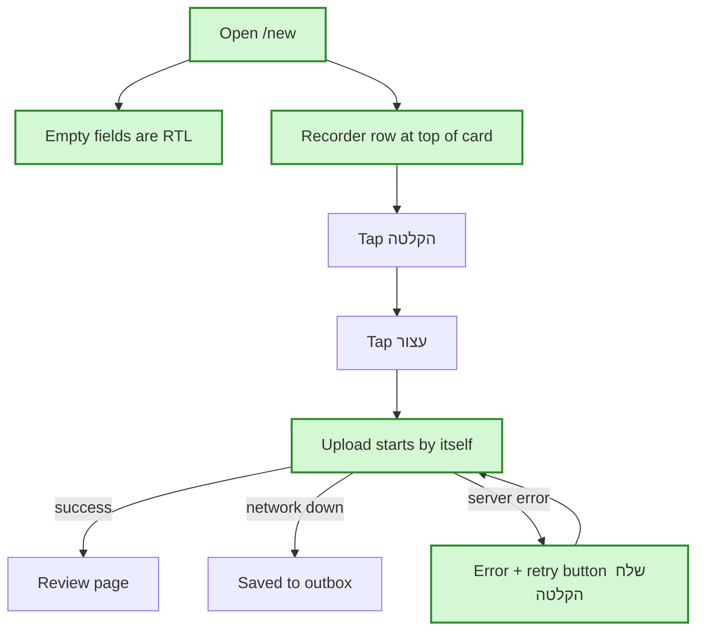

# Issue #90 plan — in simple words

**In one sentence:** On the add-note page, the empty text box starts right-to-left, the voice recorder moves to the top with bigger buttons, and pressing "עצור" sends the recording right away.

## The flow after the change

Green = new or changed steps.

## Empty fields start RTL (ticket 1)

**Today:** the title and body have `dir="auto"`. That works once you type, but an empty box shows the caret and placeholder on the left.
**After the change:** an empty box is RTL. Once it has text, `dir="auto"` takes over again.
**Example:** you open "פתק חדש" and the cursor is already on the right. If you type "hello", the box switches to LTR.
**What we gain:** Hebrew typing starts in the right place, and English notes still work.

## Recorder on top, bigger (ticket 2)

**Today:** the record button is small (`btn-sm`) and sits under the textarea.
**After the change:** it's the first row of the card, with standard-size buttons (15px text, 40px tall).
**Example:** you open the page and "🎤 הקלטה" is the first thing you see, easy to tap on a phone.
**What we gain:** voice is one tap away, with a bigger tap target.

## Stopping sends the recording (ticket 2)

**Today:** הקלטה → עצור → you also have to tap "שלח הקלטה".
**After the change:** tapping עצור uploads immediately and shows "מעלה ומתמלל…". The send button appears only if the upload fails, as a retry, so the recording isn't lost. Leaving the page or tapping "מחק הקלטה" mid-recording never uploads anything.
**Example:** you record 10 seconds, tap עצור, and land on the review page without another tap.
**What we gain:** one step fewer for every voice note, with no accidental sends.

## What is NOT changing
- No API, database or translation changes.
- The edit screen (`NoteEditor`) keeps plain `dir="auto"`.

## Watch out for
- Empty fields are RTL even in the English UI. If you want LTR there instead, it's a one-word change.
- Text typed in the body is still dropped when you send a voice note. That's existing behaviour; I'd do it as a separate issue.
- E2E won't actually record, because that would call real transcription. Unit tests cover the recording flow.
