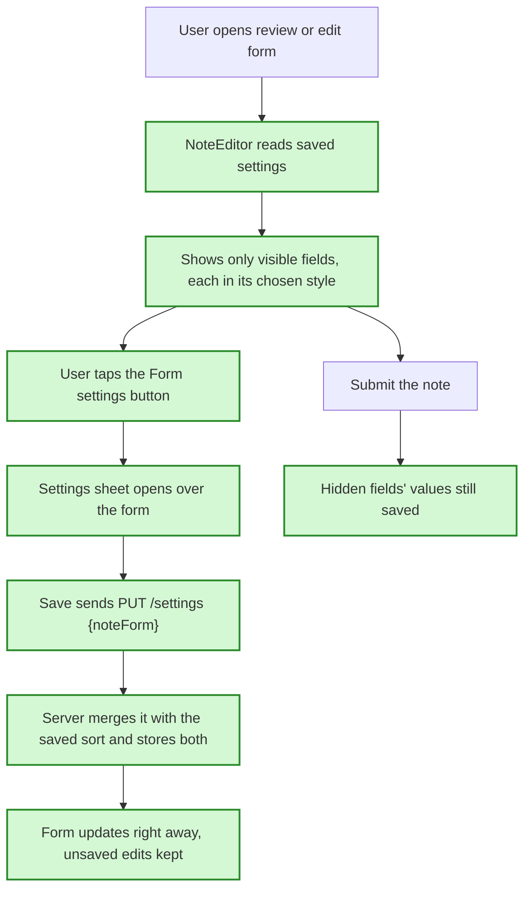

# Customizable note form (#93), in simple words

**In one sentence:** a new "Form settings" button on the note form lets each user hide optional
fields and choose how importance and urgency look (a dropdown or buttons) and which of their values
are offered. The choice is saved to the user's account, so every device gets it.

## The flow after the change

_Green = added or changed by this plan._

## Saving the settings (server)

**Today:** the server stores one setting per user, the note sort. Saving sends the whole settings
object and the server sends back exactly what it received.
**After the change:** the same database row gets one more column holding the form settings.
Saving now accepts just the part being changed and merges it with what is already stored.
**Example:** Dror switches the sort to "newest". Only `{noteSort}` is sent, and the hidden "due
date" setting stays as it was. Before this change, sending only part of the settings would have
reset the rest.
**What we gain:** changing the sort and changing the form can never erase each other, even when
one of them hasn't loaded yet (for example offline).

## The form follows the settings

**Today:** the review/edit form always shows title, categories, due date, importance and urgency,
and importance and urgency are always dropdowns.
**After the change:** each optional field shows only if it is turned on. Importance and urgency
show as a dropdown or as a row of buttons, and offer only the values chosen. Body and status always
show.
**Example:** urgency is set to buttons with "Medium" hidden. A new note shows four buttons: none,
not critical, critical, urgent. An old note already set to "Medium" still shows "Medium" selected.
**What we gain:** a shorter form fitted to how Dror actually works. It also covers import review
and the offline outbox, because they use the same form.

## Hidden doesn't mean deleted

**Today:** n/a.
**After the change:** a hidden field's value is kept. On edit, the note's existing value stays. On
a draft, Claude's suggestion is still saved.
**Example:** urgency is hidden and Claude suggests "critical". The note is saved as critical and
still sorts correctly in the list.
**What we gain:** a display setting can never lose data.

## The settings sheet

**Today:** there are no form settings.
**After the change:** a button in the form header opens a bottom sheet. It lists the fields in
form order. A hidden field "folds" into one muted line, so the sheet looks like a preview of the
form. Save updates the form at once, and Cancel throws the changes away.
**Example:** turn off "Due date", then tap "Save settings". The sheet closes and the due date field
is gone, while the text already typed into the draft is still there.
**What we gain:** settings are changed right where they apply, without leaving the note being
written.

## One shared button-group control (prefactor)

**Today:** the button group for a category's importance is written inside one component.
**After the change:** that button group becomes one shared `Segmented` control, used by category
importance, by button mode in the form, and by the "Show as" switch in the sheet.
**What we gain:** the button-group code exists once, so a fix lands in all three places.

## What is NOT changing

- Body and status cannot be hidden.
- The compose page (`/new`) stays as it is.
- The sort menu still works the same way.

## Watch out for

- If the stored settings get corrupted, the form falls back to defaults and the server logs a
  warning.
- The last offered value of a choice field can't be turned off.
