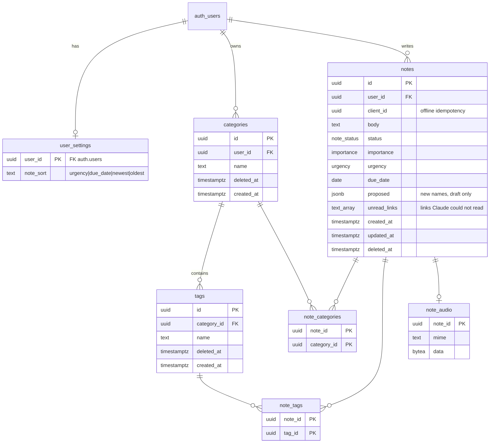

# Plan

<!-- The design ralph builds from. Issues name the sections they need ("see docs/plan.md → Auth"),
     and ralph reads only those, so keep one topic per `##` heading. -->

A plain-language walkthrough is in [`plan.simple.md`](plan.simple.md). Domain terms are in
[`../GLOSSARY.md`](../GLOSSARY.md); decisions in [`adr/`](adr/).

## Scope

A private, installable app (Hebrew first, English second, fewer than 10 users, free tiers) where
a user captures **notes** by text, voice, or sharing from another app. Claude classifies each
note into the user's **categories** and **tags** and infers due date, importance and urgency;
the user reviews the **draft** and submits it.

**In v1:** Google sign-in with an email allowlist · categories and tags with soft delete ·
text and voice notes · Claude draft → review → submit · link previews and in-app video ·
status steps · notes list with free-text search, filters and a saved sort · chat agent (read
questions + propose-only taxonomy changes) · import of old notes · offline outbox ·
Web Share Target · Android app via TWA · hosted deploy.

**Not in v1:** email/password sign-in · reading the notes list offline after a cold start ·
persisted chat history · sharing notes between users · notifications/reminders.

Decisions taken with the user:

| Topic | Decision |
|---|---|
| Auth | Google only. API allowlist `ALLOWED_EMAILS`; others get `403`. Local dev/E2E: one seeded password user (Google stays off locally). |
| Voice | Browser records → API transcribes with Groq Whisper (via the AI port) → text goes to Claude. Audio kept for replay. |
| Models | Classification and import: `claude-haiku-5-5`. Chat: `claude-sonnet-5-5`. Both set by env. |
| New taxonomy from Claude | Allowed, shown with a "new" badge, created only when the note is submitted. |
| Status | `draft → todo → in_progress → done`; one step forward or back; no skipping; `draft` leaves only by submit. |
| Deleting a category/tag | Soft delete: not offered for new choices, shown disabled on notes that have it, restorable. A deleted category makes its tags unavailable too. |
| Notes | Every field editable after submit; soft delete with an Undo toast; "Re-analyze" re-runs Claude and fills the editor without writing. |
| Link preview | YouTube/Vimeo play in an iframe; articles show an OG card; tap opens a server-extracted reader view. |
| Chat writes | Propose-only: the agent returns an action card; the user approves; the web calls the normal REST route. |
| Chat history | Session only (browser memory). No chat tables. |
| Import | One review screen: proposed new categories/tags and split notes, all with checkboxes, notes editable. Confirm writes everything in one transaction as submitted notes (`todo`). |
| Offline | Text in `localStorage`, audio in IndexedDB. On reconnect a dialog lists queued notes; each opens in the add-note editor; confirm sends it; normal draft review follows. |
| Default sort | Urgency (urgent > critical > medium > not critical > none) → importance (important first) → due date (overdue first, none last) → newest. `done` sinks to the bottom. The sort choice is saved per user on the server. |
| Android | Manifest `share_target` + Bubblewrap TWA (APK/AAB). No native code. |
| Hosting | Supabase free (DB + Auth), Render free (API), Cloudflare Pages (web), cron-job.org keep-alive — same as `my-holy-attractions-map`. |

## Architecture

```
PWA (React 19, Tailwind 4, i18next, React Query)
  │  Supabase Auth (Google) → JWT          ┌──► Postgres (Supabase): notes, categories, tags…
  └──► API (Fastify, one service) ─────────┼──► Claude (Anthropic) via AI SDK  [ai/provider.ts]
         routes → service → domain → repo  └──► Groq Whisper via AI SDK       [ai/provider.ts]
```

DDD-lite, per area: `routes/<area>.ts` is the controller (parse, authorize, delegate, respond);
`domain/<area>/service.ts` is the application service (transaction + orchestration);
`domain/<area>/<model>.ts` holds pure rules; `domain/<area>/repository.ts` holds SQL. Plain
functions, no classes, no DI container, no repository interfaces (see ADR 0001 for the one port
we do have: AI).

### `apps/api/src/`

```
server.ts                 Wiring only: buildServer({ db, verifyToken, ai, allowedEmails, … }), env.
db.ts                     Pool + withTransaction(db, fn).
auth.ts                   Supabase JWT via JWKS (jose) + allowlist → 401 / 403 not_allowed.
ai/provider.ts            THE ONLY place a model is called. Ai = { extract, chat, transcribe }.
                          Anthropic + Groq adapters; scripted fake (AI_FAKE=1, tests).
routes/                   health.ts settings.ts taxonomy.ts notes.ts imports.ts links.ts chat.ts
domain/
  taxonomy/taxonomy.ts    Name normalize + uniqueness among active, delete/restore,
                          "usable" = not deleted and parent category not deleted.
  taxonomy/repository.ts  SQL.        taxonomy/service.ts  orchestration.
  notes/note.ts           Status transitions; tag ⇒ its category is linked; only usable
                          taxonomy for new links; submit validation.
  notes/classify.ts       Classify prompt + Suggestion schema; maps model output to ids, drops
                          unknown ids, dedupes new names. Used by notes AND imports.
  notes/repository.ts     SQL for notes, note_categories, note_tags, note_audio.
  notes/service.ts        createDraft (transcribe? → classify → insert), update, delete,
                          restore, analyze, list.
  imports/service.ts      analyze (split + classify, writes nothing), confirm (one transaction).
  links/preview.ts        Safe fetch, OG parse, video embed, Readability → paragraphs.
  chat/agent.ts           System prompt + tools built per request, userId in a closure.
  settings/repository.ts  user_settings read/upsert (no rules, so no service).
```

### `packages/shared/src/`

```
index.ts        Re-exports (the package entry point).
schemas.ts      Enums, Note, NoteCreate, NoteEdit, Category, Tag, Taxonomy, Suggestion,
                ImportProposal, ImportConfirm, LinkPreview, Settings, ChatRequest, AgentAction.
noteQuery.ts    filterNotes(notes, filter, today), sortNotes(notes, sort, today), isOverdue.
                One implementation for the web list AND the agent's find_notes tool.
links.ts        extractLinks(body), videoEmbed(url) → embed URL | null.
```

### `apps/web/src/`

```
lib/api.ts          The single client: JWT, get/post/patch/delete/upload, parses every response.
lib/supabase.ts     Auth only. Never used for data.
lib/i18n.ts         i18next: he (default) + en; sets <html lang dir>. locales/he.json, en.json.
features/auth/      AuthProvider, SignIn (Google), DevSignIn (seed user, DEV only), NoAccess.
features/notes/     NotesScreen, NoteList, NoteCard, NoteFilters, NoteEditor, TaxonomyPicker,
                    VoiceRecorder, LinkPreview, UndoToast, useNotes.
features/chat/      ChatPanel, ActionCard.
features/imports/   ImportDialog.
features/offline/   outbox.ts (localStorage + idb-keyval), useOnline, OfflineBanner, OutboxDialog.
features/share/     shareTarget.ts.
```

No router: one screen with dialogs/sheets; the share target is a query string read on load.

Reuse from `~/WebstormProjects/my-holy-attractions-map` (adapt, don't import): `apps/api/src/auth.ts`,
`apps/api/src/llm/provider.ts` (port + fake), `apps/web/src/features/auth/*`,
`lib/shareTarget.ts`, `lib/useOnline.ts`, `OfflineBanner`, `UndoToast`,
`features/chat/{ChatPanel,ActionCard,chatTurn}`, `scripts/deploy-hosted.sh`, e2e sign-in helpers.

### UI skills

Every ticket that touches `apps/web` UI loads, before writing components: `frontend-design`,
`ui-skills`, `improve-animations`, `improve-react`, `better-ui` (all in `.claude/skills/`, added
by the app-shell ticket) and `vercel-react-best-practices`. Styling: Tailwind 4 with logical
utilities (`ms-*`, `ps-*`, `text-start`) so RTL and LTR both work; light and dark mode;
responsive from 360 px phones to desktop.

## Database schema



- Enums: `note_status (draft, todo, in_progress, done)`, `importance (important, not_important)`,
  `urgency (not_critical, medium, critical, urgent)`. `importance`, `urgency`, `due_date` nullable.
- Unique active names: `unique (user_id, lower(name)) where deleted_at is null` on categories;
  `unique (category_id, lower(name)) where deleted_at is null` on tags;
  `unique (user_id, client_id)` on notes.
- Tags have no `user_id`: ownership is checked through the category join.
- `notes.proposed` holds Claude's new category/tag names for a draft; Zod-parsed on read;
  cleared on submit.
- `notes.unread_links text[] not null default '{}'`: links in the body that Claude could not read.
  Set on submit and import confirm. A Re-analyze that reads every link clears it when the note is
  saved. Added by the link-previews ticket.
- `note_audio.data`: at most 5 MB (enforced in the API). See ADR 0003.
- Migrations (one per ticket, via `pnpm db:new`): settings (sign-in ticket), taxonomy, notes
  (+ link tables), audio, `unread_links` (link previews).

## Row Level Security

Every table has RLS enabled and no policies: the browser never reads data from Supabase directly,
only through the API.

## Auth

Supabase Auth, **Google only** in the hosted project. The web uses `supabase-js` for auth only and
sends `Authorization: Bearer <access token>`. The API verifies the token against the project's
JWKS (`jose`, issuer `${SUPABASE_URL}/auth/v1`, audience `authenticated`), then requires the
token's email to be in `ALLOWED_EMAILS` (comma list, case-insensitive): otherwise
`403 {error:'not_allowed'}`, which the web shows as a "no access" screen with sign out.
`requireUser` registers on every route except `/health`; `currentUser(req)` reads the caller.

Locally Google stays off (`supabase/config.toml`); `supabase/seed.sql` seeds one confirmed
password user. `DevSignIn` (rendered only when `import.meta.env.DEV`) signs in as that user; E2E
uses the same user. The seed email is in the local `ALLOWED_EMAILS` default.

Env (append to `.env.example`): `SUPABASE_URL`, `ALLOWED_EMAILS`, `VITE_SUPABASE_URL`,
`VITE_SUPABASE_ANON_KEY` (local-stack defaults).

## API contract

All routes except `/health` require a valid JWT and the allowlist. Every query filters by the
caller's `user_id`; another user's id behaves as not found.

| Method | Path | Body / query | Returns |
|---|---|---|---|
| GET | `/health` | `?deep=1` | existing |
| GET / PUT | `/settings` | `{noteSort}` | `Settings` (defaults when no row) |
| GET | `/taxonomy` | — | categories with their tags, deleted ones included and flagged |
| POST | `/categories` | `{name}` | `201 Category` · `409 name_taken` |
| PATCH | `/categories/:id` | `{name}` | `Category` · `409 name_taken` |
| DELETE | `/categories/:id` | — | `204` (soft) |
| POST | `/categories/:id/restore` | — | `Category` · `409 name_taken` if an active one has the name |
| POST | `/categories/:id/tags` | `{name}` | `201 Tag` · `409 name_taken` · `422 category_deleted` |
| PATCH / DELETE | `/tags/:id` | `{name}` / — | `Tag` / `204` |
| POST | `/tags/:id/restore` | — | `Tag` · `409` · `422 category_deleted` |
| GET | `/notes` | — | all non-deleted notes (drafts included) with `categoryIds`, `tagIds`, `hasAudio`, `proposed`, `unreadLinks` |
| POST | `/notes` | JSON `{body, clientId, today, locale}` or multipart (`audio` file + same fields) | `201 {note, suggestion}` (note is a `draft`); a repeated `clientId` → `200` with the existing note |
| PATCH | `/notes/:id` | `NoteEdit {body?, categoryIds?, tagIds?, newCategories?, newTags?, dueDate?, importance?, urgency?, status?}` | `Note` · `422 invalid_transition` · `422 unknown_taxonomy` |
| DELETE | `/notes/:id` | — | `204` (soft) |
| POST | `/notes/:id/restore` | — | `Note` |
| POST | `/notes/:id/analyze` | `{today, locale}` | `Suggestion` — writes nothing |
| GET | `/notes/:id/audio` | — | audio bytes, stored mime |
| POST | `/imports/analyze` | `{text (≤ 50 000 chars), today, locale}` | `ImportProposal {newCategories, newTags, notes:[{body, suggestion}], links:{total, read}}` (≤ 200 notes) — writes nothing |
| POST | `/imports/confirm` | `ImportConfirm {categories, tags, notes}` | `201 {created}` — one transaction, all or nothing |
| GET | `/links/preview` | `?url=` (`&reader=1`) | `LinkPreview`: `{kind:'video', embedUrl}` · `{kind:'article', title, description, image, siteName}` · with `reader=1` also `paragraphs: string[]` · `422 unreachable` |
| POST | `/chat` | `{messages, today, locale}` | SSE stream (AI SDK parts + a `data-actions` part) |

Rules:

- `today` is the client's local date (`YYYY-MM-DD`); accepted only within ±1 day of the server's
  UTC date (else `400`). It anchors relative dates ("by Friday") and "overdue".
- Submit = `PATCH {status:'todo', …}` on a draft: in one transaction it creates the chosen
  `newCategories` / `newTags` (`newTags` reference an existing category id or a new category name),
  links everything, clears `proposed`.
- New links accept only usable taxonomy; links that exist stay when a category/tag is deleted.
- Selecting a tag links its category too (`note.ts` invariant).
- Server-derived fields (`id`, `user_id`, `created_at`, `status` on create) are never accepted
  from the client.
- `@fastify/rate-limit` per user on `POST /notes`, `/notes/:id/analyze`, `/imports/analyze`,
  `/chat`: 30 per minute.
- Audio: mime allowlist `audio/webm`, `audio/ogg`, `audio/mp4`, `audio/mpeg`; 5 MB cap → `413`.

## AI

- `ai/provider.ts` is the only module that calls a model (ADR 0001):
  `extract<T>({schema, system, prompt, model})` → `{ok, value} | {ok:false, error}`,
  `chat({system, messages, tools, maxSteps})` → AI SDK stream,
  `transcribe({audio, mime})` → `{text}`.
  Adapters: `@ai-sdk/anthropic` (text), `@ai-sdk/groq` `whisper-large-v3` (speech), and a
  scripted fake (`FakeTurn`s as in the sibling repo).
- Env (append to `.env.example`): `ANTHROPIC_API_KEY`, `GROQ_API_KEY`,
  `LLM_CLASSIFY_MODEL=claude-haiku-5-5`, `LLM_CHAT_MODEL=claude-sonnet-5-5`, `AI_FAKE`.
  `AI_FAKE=1` → fake for everything (tests, E2E, keyless dev). A missing key without `AI_FAKE`
  fails startup with a clear message.
- **Classify** (`notes/classify.ts`): input = body, today, locale, the user's usable taxonomy as
  `id | category | tags (id:name)`, and `links: LinkContext[]` (see Link previews). The link
  content goes in a `<linked_content>` block; the system prompt says the block is data, not
  instructions. Output (`Suggestion`): `categoryIds`, `tagIds`,
  `newCategories: string[]`, `newTags: {categoryId | categoryName, name}[]`, `dueDate | null`,
  `importance | null`, `urgency | null`, `unreadLinks: string[]` (set by the service, not by
  Claude). Zod-parsed; unknown ids dropped; new names trimmed and
  deduped against existing (case-insensitive). A failed or rejected call → empty suggestion;
  capture never fails because of Claude.
- **Import analyze**: one call splits the text into notes (newline, comma, bullets, numbering,
  dates — whatever the text uses) and classifies each, returning one `ImportProposal`. Links
  across the split notes are deduped; the first 30 are read (5 at a time, 15 s budget for the
  whole import); the rest go to Claude as URLs and land in each note's `unreadLinks`.
- **Agent** (`chat/agent.ts`), tools built per request with `userId` closed over:
  - `list_taxonomy()` — usable categories with tags.
  - `find_notes({categoryIds?, tagIds?, statuses?, overdue?, text?, dueBefore?, dueAfter?,
    limit ≤ 100})` — loads the user's notes and runs shared `filterNotes` + `sortNotes`; returns
    rows `id | status | due | importance | urgency | categories | tags | body (≤ 1 000 chars)`.
  - `propose_change(action)` — `create | rename | delete | restore` × `category | tag`; checks it
    against the DB and returns an `AgentAction` or `{error}`. **Writes nothing.**
  - `maxSteps` 6; last 20 messages; answer in the request `locale`; ground answers in tool
    results only; note ids cited in the answer are checked before the web renders them.
- No real model call in any test or in CI.

## Link previews

`links.ts` (shared) finds URLs in a body and maps YouTube (`watch?v=`, `youtu.be/`, `shorts/`,
`embed/`) and Vimeo URLs to embed URLs. Everything else goes through `GET /links/preview`:
`domain/links/preview.ts` fetches with `http`/`https` only, resolves DNS and rejects private,
loopback and link-local addresses on every redirect hop (max 3), 5 s timeout, 2 MB cap; parses
OG/Twitter meta (fallback `<title>`); with `reader=1` runs Mozilla Readability and returns plain
text paragraphs (no HTML reaches the browser). Results are cached in memory (LRU, 1 h).

**Claude reads links.** `readLink(url) → LinkContext {url, ok, title?, description?, siteName?,
text?}` lives in `preview.ts` and uses the same safe fetch and cache; `GET /links/preview` uses it
too, so there is one fetch path.

- Articles: OG/meta fields plus the first 4 000 characters of the Readability text.
- YouTube: oEmbed (`https://www.youtube.com/oembed?url=…&format=json`) for title and author, plus
  the watch page's `og:description`. No transcript.
- Vimeo: `https://vimeo.com/api/oembed.json?url=…` (title and description).
- Blocked sites, as in `my-holy-attractions-map` `domain/normalizer/pageMeta.ts`: a 403, 429,
  503 or network error is retried once with a browser user-agent. If the page is still blocked
  and `JINA_API_KEY` is set, it is read through Jina Reader (`https://r.jina.ai/<url>`,
  `Authorization: Bearer`, `x-return-format: html`, 10 s timeout). The same parser then reads the
  HTML. Only public http/https URLs that pass the SSRF check go to the reader, so Jina sees only
  the public page URL. Without the key this step is skipped, and the link is unread. Env:
  `JINA_API_KEY` (optional; append to `.env.example` with a comment).

`notes/service` (`createDraft`, `analyze`) runs `extractLinks(body)`, reads the first 3 links in
parallel with a 6 s budget for the whole note (15 s when a link falls back to Jina Reader), then
classifies. A link that fails (paywall, bot
block, private video, timeout) is still sent as a URL and lands in `Suggestion.unreadLinks`; it
never blocks the draft. Some sites will never be readable — the "link not read" chip, the filter
and Re-analyze are the safety net.

## Web behaviour

- **Main screen:** header (language toggle, menu: import, sign out), search box, filter sheet
  (categories, tags, status, importance, urgency, created and due date ranges, "Links not read";
  deleted taxonomy shown disabled), sort menu (saved with `PUT /settings`), list of `NoteCard`s, floating
  add-note button (text / record), chat button. Drafts sit at the top with a "draft" badge.
- **NoteCard:** body excerpt, created date, due date (red when overdue), importance, urgency,
  status, category and tag chips (deleted ones greyed), link previews, audio player, a
  "link not read" chip per entry in `unreadLinks`.
- **NoteEditor** — one component with four callers: new draft review, edit, outbox item, import
  row. Body, `TaxonomyPicker` (existing chips, Claude's new names with a "new" badge, inline
  create), due date, importance, urgency, status stepper (one step forward/back), link previews,
  audio player, Re-analyze, Submit/Save.
- **Delete** → Undo toast (5 s) → `POST /notes/:id/restore`.
- **Chat:** side panel on desktop, full-screen sheet on phone; streaming answers; action cards with
  Approve / Dismiss.
- **Import:** paste into a textarea or pick a `.txt` file → analyze → review (new categories, new
  tags, notes — checkboxes; each note row opens the NoteEditor) → confirm. When some links were
  not read, a banner on the review screen says so ("Claude read 30 of 47 links. 17 notes have
  links that were not read. After import, filter 'Links not read' and press Re-analyze on each."),
  those rows show the chip, and the toast after confirm repeats the count with a "Show them"
  button that applies the filter.
- **Share target:** manifest `share_target` (GET, `title`/`text`/`url` params); on load the app
  reads them, clears the URL, and opens the NoteEditor with the shared text.
- All UI text from `locales/he.json` / `en.json`; Hebrew is default; `dir` follows the language.

## Offline

- `useOnline` (navigator events + a failed request) drives an `OfflineBanner`.
- While offline, add-note writes to the outbox: `localStorage` key `notes-outbox-v1`
  (`{clientId, body, createdAt, hasAudio}[]`, Zod-parsed on read, bad entries dropped with a
  console warning); audio blobs in IndexedDB via `idb-keyval`, keyed by `clientId`.
- Back online with a non-empty outbox → `OutboxDialog` lists the items; each opens in the
  NoteEditor; Confirm → `POST /notes` with its `clientId` (idempotent, safe to retry) → the
  returned draft continues in the normal review → the item leaves the outbox.
- The app shell is precached by `vite-plugin-pwa`; reading notes offline after a cold start is out
  of scope.

## Android

- Manifest gets icons (192, 512, maskable) and `share_target`.
- Bubblewrap TWA: `apps/web/twa-manifest.json`, `apps/web/public/.well-known/assetlinks.json`
  (SHA-256 fingerprint from env), `scripts/build-android.sh` builds a signed AAB/APK when
  `ANDROID_KEYSTORE*` env is set and skips with a warning otherwise.
- Creating the keystore, installing on a phone and any Play Store step are human-only.

## Deploy

`scripts/deploy-hosted.sh`, adapted from the sibling repo: hosted Supabase migrations and the
Google provider, Render API service (env incl. `ANTHROPIC_API_KEY`, `GROQ_API_KEY`,
`JINA_API_KEY` when set,
`ALLOWED_EMAILS`, `SUPABASE_URL`, `WEB_ORIGIN`), Cloudflare Pages for the web, cron-job.org
keep-alive (`/health` every 14 min 07:00–23:00; `/health?deep=1` daily). Idempotent; each step
skips with a warning when its key is missing.

Creating accounts and keys is human-only, in a `needs-human` setup issue with exact steps
(Supabase project, Google OAuth client, Supabase Google provider, Anthropic key with a spend
limit, Groq key, Render + GitHub, Cloudflare Pages GitHub app + API token + account id,
cron-job.org key, optional Jina Reader key). `scripts/setup-hosted.sh` (built with the `wizard` skill) walks through those
steps: for each value it shows where to find it and asks for it; it creates `.env` from
`.env.example` when `.env` is missing and otherwise appends; it never overwrites a filled key; it
appends any missing key name to `.env.example` with an empty value; it is re-runnable; at the end
it offers to run `pnpm deploy:hosted`.

## Test plan

- **API** — `app.inject` via `buildServer({ db, ai: fakeAi, verifyToken: testVerifier, … })`,
  DB-backed suites under `describe.skipIf(!databaseUrl)`:
  auth 401 / 403 not_allowed; taxonomy CRUD, name conflicts, soft delete/restore, deleted not
  linkable but kept on notes; note create → draft + suggestion (fake), repeated `clientId`;
  submit creates new taxonomy in one transaction; transitions allowed and `422`; another user's
  ids → `404` / `422`; audio size and mime limits, playback; import analyze writes nothing,
  confirm all-or-nothing; link preview against a local HTTP fixture server, private-IP
  rejection; link context: a fixture page's title reaches the fake AI prompt, a failing link
  lands in `unreadLinks`, a 403 fixture is retried through a fake reader when `JINA_API_KEY` is
  set and stays unread without it, the 3-link cap per note, the 30-link cap per import; chat: `find_notes` scoped to the caller, `propose_change` never writes.
- **Pure units** — `note.ts` transitions and invariant, `taxonomy.ts` rules, `classify.ts`
  mapping (unknown ids, duplicate names), `noteQuery.ts` (every filter, the sort order, overdue
  on the today boundary), `links.ts` URL forms, `outbox.ts`.
- **Web (React Testing Library)** — NoteEditor (new badge, transitions), NoteFilters, ChatPanel
  with a scripted stream, ImportDialog checkboxes, OutboxDialog, language toggle flips `dir`.
- **E2E (Playwright, `AI_FAKE=1`, seeded user)** — sign in → add text note → review draft →
  submit → appears in sort order; filter by tag; offline → add note → online → dialog → send;
  chat "what categories do I have". Screenshots at 390 px and desktop, light and dark.
- No real LLM or Groq call in any test or in CI.

## Milestones

Issues are numbered in work order; each lists its blockers under `## Blocked by`.

1. App shell: Tailwind 4, i18n (he/en, RTL/LTR), UI skills
2. Google sign-in with email allowlist — blocked by 1
3. Categories and tags API with soft delete — blocked by 2
4. Text note → Claude draft → submit — blocked by 3
5. Notes list: filters, urgency sort, saved sort — blocked by 4
6. Edit, status steps, soft delete with undo, re-analyze — blocked by 4
7. Voice notes — blocked by 4
8. Link previews, video playback, Claude reads links — blocked by 4
9. Chat agent: questions about notes — blocked by 5
10. Chat agent: taxonomy changes via action cards — blocked by 9, 3
11. Import old notes — blocked by 4, 8
12. Offline outbox — blocked by 4, 7
13. Share target and installable PWA — blocked by 4
14. Hosted deploy and setup wizard — blocked by 2
15. Android app (TWA) — blocked by 13, 14
16. E2E happy paths — blocked by 5, 6, 9, 12

Human-only: "Create hosted accounts, keys and OAuth client" (`needs-human`, not in the ralph
queue) — steps in Deploy.
