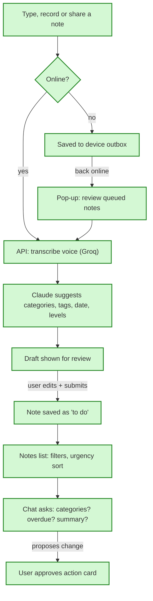

# Notes Organizer v1, in simple words

**In one sentence:** you capture a note by typing, speaking or sharing from another app. Claude suggests its categories, tags, due date, importance and urgency. You check the draft and submit it. Then you can filter your notes, ask a chat assistant about them, import old notes and keep working offline, on the web or as an Android app.

## The flow after the change

Green = new. Today the app only shows "server is up".

## Sign-in
**Today:** no sign-in.
**After the change:** sign in with Google. Only emails on an allowed list get in. Everyone else sees a "no access" screen.
**Example:** a stranger who finds the URL signs in with Google and is stopped. You get in.
**What we gain:** strangers can't spend your Claude credits. Email/password sign-in comes later.

## Categories and tags
**Today:** none.
**After the change:** each user has categories (such as "Finance"), and each category has tags (such as "Index investing"). Deleting one only hides it. Old notes still show it, greyed out, and you can restore it.
**Example:** you delete "Hobbies". New notes can't pick it, but last month's guitar note still shows it in grey.
**What we gain:** nothing is lost by mistake.

## Adding a note
**Today:** none.
**After the change:** you type a note. Claude reads it with your existing categories and suggests where it belongs. It may also suggest new categories or tags, marked "new". These are created only when you submit.
**Example:** "Read the article on index funds by Friday" gives Finance › Index investing, due Friday, urgency Medium. You change the urgency and submit.
**What we gain:** organizing a note takes one review instead of manual tagging.

## Notes list
**Today:** none.
**After the change:** search box plus filters for category, tag, status, importance, urgency and dates. Most urgent notes come first by default. Your sort choice follows you to other devices.
**Example:** you pick "Due date" sort on your laptop. Your phone opens with the same sort.
**What we gain:** the same filter code serves the screen and the chat, so they always agree.

## Status and editing
**After the change:** a note moves to do → in progress → done, one step at a time, forward or back. You can edit any field. Delete has Undo. "Re-analyze" asks Claude again.
**Example:** you mark a note done by mistake, then tap back one step to "in progress".

## Voice notes
**After the change:** you record in the app. The server turns the speech into text (Groq Whisper), then Claude classifies it. The recording stays for replay.
**What we gain:** you can capture a note hands-free, in Hebrew.

## Links and videos
**After the change:** YouTube and Vimeo links play inside the note. Article links show a card, and a tap opens a clean reading view.
**What we gain:** you don't leave the app to see what a note points to.

## Chat assistant
**After the change:** you can ask "What categories do I have?", "Which tags are in Finance?", "Summarize Finance with tags X, Y" or "What's overdue?". It can also suggest adding, renaming, deleting or restoring categories and tags. Nothing changes until you approve the change card.
**What we gain:** quick answers. Text inside a note can't trick the assistant into changing your data.

## Import
**After the change:** you paste text or upload a .txt file. Claude splits it into notes and suggests new categories and tags. You tick what to keep and edit rows, then confirm. Everything is saved together, or nothing is.

## Offline
**After the change:** a banner shows when you're offline. Notes you add, voice included, wait on the device. When you're back online, a pop-up opens each note in the add-note screen. Confirming sends it, and it continues as a normal draft.
**What we gain:** nothing typed on the train is lost. Sending twice can't create duplicates.

## Android
**After the change:** "Share → Notes" from any Android app opens add-note prefilled. A Bubblewrap build turns the PWA into an installable Android app (APK/AAB) without native code.

## Hosting and AI providers
Everything runs on free tiers: Supabase, Render, Cloudflare Pages. Claude Haiku 5.5 classifies, Claude Sonnet 5.5 chats, and Groq transcribes, all behind one swappable "AI port" (the single module the rest of the code calls for AI). Tests use a scripted fake AI, so they never call a real model.

## Work order
16 GitHub issues for ralph:
- Shell and sign-in come first.
- Then taxonomy, and the text-note tracer (the first thin feature that runs end to end).
- Then list, edit, voice, links, chat, import, offline and share, mostly in parallel.
- Deploy, Android and E2E tests come last.

## Watch out for
- Ralph can't do the human-only steps: Google OAuth keys, Anthropic/Groq keys, Render/Cloudflare accounts and the Android signing keystore. Those get their own `needs-human` issues.
- Notes added offline after the app was fully closed can still be queued. But the existing notes list can't be read on a cold start while offline.
